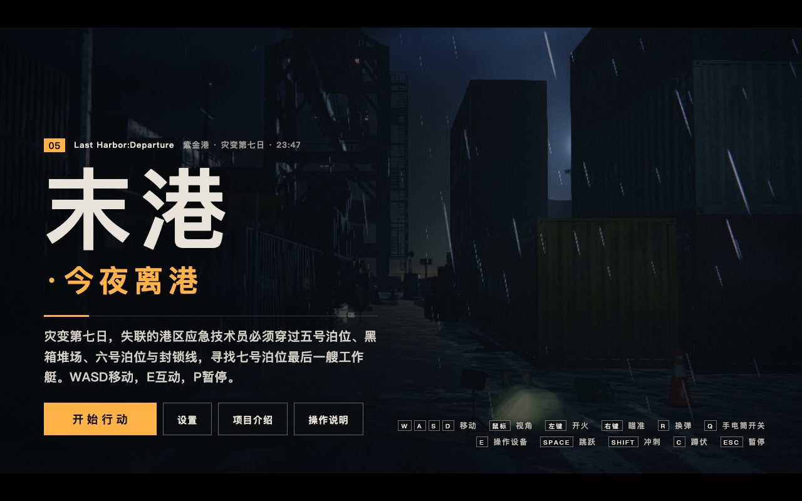

# Last Harbor: Departure

English | [简体中文](README.zh-CN.md)

> One harbor. One last boat. No rescue is coming.

**A five-chapter first-person survival horror game set in a rain-soaked industrial harbor. Survive infected workers and hostile security forces, restore the port's infrastructure, and find a way out before dawn.**

[](docs/media/last-harbor-title.png)

**[Play Online](https://lastharbor.zhuiguang.tech/)** · [Run locally](#getting-started) · [Credits](CREDITS.md)

*Online demo: release pending.*

## About the game

Last Harbor: Departure is a complete, single-player story about surviving a night inside a sealed cargo port. Move between cramped container lanes, exposed loading yards and industrial control corridors, with limited ammunition and machinery that still answers to somebody.

The five chapters form one continuous campaign. Chapter briefings, dialogue, radio transmissions and HUD messages carry the story through to its conclusion. In-game narrative text is in **Simplified Chinese**.

The game expands on **Saltline**, the game from [Felix Rieseberg's](https://github.com/felixrieseberg) Claude Fable 5.2 experiment. Its harbor environment and core rendering and game technology remain the foundation of this adaptation. See [Credits](CREDITS.md) for the original game, Chinese localization and added assets.

## Story

**Zijin Harbor, 2029.** A cargo ship returns from the open sea after losing contact. Soon, reports of infection spread through the docks. Emergency restrictions become a full lockdown. The evacuation stops before everyone can leave.

Seven days later, at 23:47, you are an emergency maintenance technician separated from your team. Rain beats against abandoned containers. The radios offer little but static. Somewhere beyond the darkened yards, a port announcement keeps repeating: the last boat is leaving from Berth 7.

Reaching the waterfront means crossing a harbor whose power, gates and fuel systems no longer work as they should. You know how to repair the machinery. You do not know whether the voice on the loudspeakers is guiding you toward safety. Before dawn, you will have to find out.

### Five chapters

| Chapter | A glimpse of the night |
| --- | --- |
| **01 — Berth 5: The Last Guard** | Familiar loading lanes feel different after the evacuation. A few lights still cut through the rain. |
| **02 — Blackbox Yard: A Road Without Light** | Container walls close around a path that is easy to lose. Beyond each turn, darkness erases the distance. |
| **03 — Berth 6: Clearance Order** | Open concrete offers little shelter beneath the floodlights. Every stretch of exposed ground feels longer than it should. |
| **04 — Lockdown: Sector 7 Control Center** | Fences and industrial corridors narrow the way toward the waterfront. The port's machinery is quieter here, but never quite silent. |
| **05 — Berth 7: Departure Tonight** | Warehouses and rain obscure the edge of the harbor. Somewhere beyond them lies the possibility of open water. |

## Features

- **First-person survival.** Manage a rifle, P12 pistol and knife, watch your ammunition, and use solid containers, vehicles and industrial cover. Equipment and controls are operated at close range.
- **A harbor in the rain.** Container stacks, cranes, warehouses and working machinery sit beneath rain, floodlights and reflected light on wet ground, beside a moving sea.
- **A complete five-chapter campaign.** Briefings, dialogue, corporate radio and HUD storytelling carry the journey from the darkened yards to the harbor’s edge.
- **Different threats.** Infected workers, armed clearance personnel, robotic hounds, drones and snipers call for different use of space and cover.
- **Faction combat.** In later encounters, infected and security forces can attack one another. A changing fight can create a brief opening to move.
- **Infrastructure as a way out.** Power, warehouse access, authorization overrides and fuel transfer make the harbor's facilities part of survival.
- **Play in a desktop browser.** Three.js and WebGL 2 power the game; use a keyboard and mouse. No separate game client is required.

## Gameplay video

[Watch the gameplay video — 1 min 14 sec](docs/media/gameplay.mp4)

## Getting started

Requires **Node.js 20 or newer**, npm, and a desktop browser with **WebGL 2** and hardware acceleration enabled.

```sh
npm ci
npm run dev
```

Open **http://127.0.0.1:4181/campaign/**. The root URL, **http://127.0.0.1:4181/**, opens the same complete campaign.

Click the game canvas to capture the mouse; the first click only captures it. A death retry restores the current chapter's entry state. Progress is held for the current session; refreshing the page starts a new session.

### Build and preview

```sh
npm run build
npm start
```

This generates `dist/` and serves it at **http://127.0.0.1:4181/**. Use HTTP rather than opening the HTML with `file://`.

For the custom-domain release at `https://lastharbor.zhuiguang.tech/`:

```sh
npm run build:pages
npm start
```

Preview at **http://127.0.0.1:4181/**. This package uses base `/` and includes the domain's `CNAME`.

For the GitHub Pages project-path fallback, use `npm run build:pages:project`, then `npm start` and open **http://127.0.0.1:4181/LastHarbor-Departure/**. This package uses base `/LastHarbor-Departure/` and has no `CNAME`.

Maintainers: see [Deployment](docs/DEPLOYMENT.md) for branch preparation, GitHub Pages and DNS setup. [Source repository](https://github.com/zhuiguang49/LastHarbor-Departure).

## Controls

| Input | Action |
| --- | --- |
| W / A / S / D | Move |
| Mouse | Look |
| Left click | Shoot / attack |
| Right click | Aim |
| 1 / 2 / 3 | Rifle / P12 pistol / knife |
| R | Reload |
| Shift | Sprint |
| Ctrl or C | Crouch |
| Space | Jump |
| Q | Toggle flashlight |
| E | Interact |
| P / Esc | Pause |
| ← / → or Space during story screens | Previous / next page; Space advances |
| Enter on the final story page | Confirm / continue |

Weapons must be picked up separately. Follow the on-screen confirmation prompt for briefings and dialogue.

## Credits

- **Original game: [Saltline](https://saltline.games/play/index.html), from [Felix Rieseberg's](https://github.com/felixrieseberg) Claude Fable 5.2 experiment.** Thank you for the harbor environment, rendering and core game technology that made this adaptation possible.
- **Chinese localization: 几猫汉化版.** Thank you for the Chinese localization used in this project.
- **[Tripo AI](https://www.tripo3d.ai/).** Selected character, equipment and environment assets were created or processed with its assistance.
- **[ElevenLabs](https://elevenlabs.io/).** AI-generated infected sound effects complement Saltline's procedural audio and the project's synthesized effects.

<p><a href="https://threejs.org/"></a> Three.js &nbsp; <a href="https://www.khronos.org/webgl/"></a> WebGL &nbsp; <a href="https://developer.mozilla.org/en-US/docs/Web/JavaScript"></a> JavaScript</p>

Full acknowledgments and technology credits: **[CREDITS.md](CREDITS.md)**.

## License & attribution

Original LastHarbor contributions use the **[PolyForm Noncommercial License 1.0.0](LICENSE)**. Modification and noncommercial redistribution are permitted with project attribution; commercial use requires separate permission. Full terms and attribution requirements are in [NOTICE](NOTICE), with third-party notices in [THIRD_PARTY_NOTICES.md](THIRD_PARTY_NOTICES.md).
