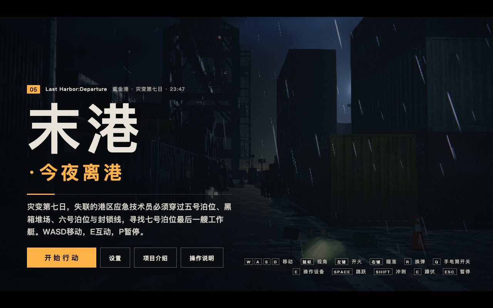
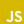

# 末港：今夜离港

[English](README.md) | 简体中文

> 一座港口，最后一艘船。不会再有救援到来。

**一款设定于雨夜工业港口的五章第一人称生存恐怖游戏。躲过感染者与敌对安保力量，重启港务设施，在天亮前寻找离开的路。**

[](docs/media/last-harbor-title.png)

**[在线试玩](https://lastharbor.zhuiguang.tech/)** · [实机视频](docs/media/gameplay.mp4) · [本地运行](#本地运行) · [致谢](CREDITS.md)

## 游戏简介

《末港：今夜离港》（Last Harbor: Departure）是一款完整的单人生存恐怖游戏。你将在封锁的货运港口度过一个漫长的夜晚，穿过狭窄货道、开阔堆场与工业控制廊道。弹药有限，而那些仍在运转的机器，似乎还在听从某个人的命令。

五个章节构成连续战役，章节报幕、人物对白、无线电与 HUD 信息共同推进故事，直到旅程结束。游戏内叙事文字为**简体中文**。

本作基于 **[Felix Rieseberg](https://github.com/felixrieseberg) 发起的 Claude Fable 5.2 实验游戏 Saltline** 扩展与改编，延续了原作的港口环境、核心渲染及游戏技术基础。原作、汉化版本与新增素材的完整署名见 [CREDITS.md](CREDITS.md)。

## 背景故事

**2029 年，紫金港**，一艘失联的远洋货轮靠岸后，异常感染逐渐扩散，繁忙的工业港口被紧急封锁。撤离中断，通讯沉寂，留下的只有暴雨和反复播放的广播。

灾变第七日，23:47。你是一名与队伍失散的应急维修技术人员，独自在黑暗的货运港区醒来。远处，七号泊位仍在宣告最后一班船即将离港。

要走到海边，你必须穿过断电的货道与封锁区，让停摆的港务设施重新运转。广播指向的是生路，还是另一个陷阱？在天亮之前，你只能亲自去确认。

### 五个章节

| 章节 | 雨夜一瞥 |
| --- | --- |
| **CHAPTER 01 — 五号泊位：最后的守卫** | 撤离结束后，熟悉的装卸道路也变得陌生。仅有的几束灯光，仍在雨幕中闪烁。 |
| **CHAPTER 02 — 黑箱堆场：没有灯的路** | 集装箱将道路挤成狭窄的缝隙。每一次转弯之后，黑暗都会抹去远处的方向。 |
| **CHAPTER 03 — 六号泊位：清除命令** | 高杆灯下，开阔的水泥地几乎没有藏身之处。每一段暴露的道路，都显得格外漫长。 |
| **CHAPTER 04 — 封锁线：第七区控制中心** | 围栏与工业廊道收紧了通向海边的路。这里的设备更加安静，却从未真正停止运转。 |
| **CHAPTER 05 — 七号泊位：今夜离港** | 仓库与暴雨遮住了港口的边缘。在它们之后，也许就是不再受围栏阻挡的海面。 |

## 游戏特色

- **第一人称生存体验。** 使用步枪、P12 手枪与匕首，管理弹药，借助集装箱、车辆和工业设施构成的实体掩体，在近距离完成拾取与操作。
- **雨夜工业港口。** 集装箱堆垛、龙门吊、仓库与港务机械置于暴雨和工业照明之下，湿地面反射灯光，海面在码头外起伏。
- **完整五章剧情。** 报幕、人物对白、企业无线电与 HUD 叙事，串起穿越港区的逃生旅程。
- **不同类型的威胁。** 感染者、武装清场人员、机械猎狗、无人机和狙击手，让距离、掩体与空间选择有不同意义。
- **多阵营战斗。** 后期遭遇中，感染者与安保力量能够真实相互攻击。观察战局，寻找混战中短暂出现的移动机会。
- **让设施成为生路。** 供电、仓库门禁、权限覆盖与燃油输送，都是港口设施与生存过程的一部分。
- **桌面浏览器运行。** 基于 Three.js 与 WebGL 2，使用键盘和鼠标游玩，无需安装独立游戏客户端。

## 实机视频

[观看实机游玩视频 — 1 分 14 秒](docs/media/gameplay.mp4)

## 本地运行

需要 **Node.js 20 或更新版本**、npm，以及支持 **WebGL 2** 并开启硬件加速的桌面浏览器。

```sh
npm ci
npm run dev
```

打开 **http://127.0.0.1:4181/campaign/** ，根地址 **http://127.0.0.1:4181/** 也会进入同一完整战役。

首次点击游戏画布仅获取鼠标锁定。死亡重试会恢复当前章节的入口状态；本局进度保留在当前页面会话中，刷新页面会开始新的会话。

### 构建与预览

```sh
npm run build
npm start
```

构建产物位于 `dist/`，预览地址为 **http://127.0.0.1:4181/** ，请通过 HTTP 访问，不要使用 `file://` 直接打开 HTML。

为正式自定义域名 `https://lastharbor.zhuiguang.tech/` 构建：

```sh
npm run build:pages
npm start
```

预览地址为 **http://127.0.0.1:4181/**。这个发布包使用根路径 `/`，并包含域名配置 `CNAME`。

GitHub Pages 项目路径备用包使用 `npm run build:pages:project` 构建，再运行 `npm start`，访问 **http://127.0.0.1:4181/LastHarbor-Departure/**。这个包使用 `/LastHarbor-Departure/`，不包含 `CNAME`。

维护者可参阅[部署说明](docs/DEPLOYMENT.md)，了解分支准备、GitHub Pages 与 DNS 配置。[源码仓库](https://github.com/zhuiguang49/LastHarbor-Departure)。

## 操作说明

| 按键 | 操作 |
| --- | --- |
| W / A / S / D | 移动 |
| 鼠标 | 观察视角 |
| 左键 | 射击／攻击 |
| 右键 | 瞄准 |
| 1 / 2 / 3 | 步枪／P12 手枪／匕首 |
| R | 换弹 |
| Shift | 冲刺 |
| Ctrl 或 C | 蹲伏 |
| Space | 跳跃 |
| Q | 手电筒开关 |
| E | 交互 |
| P / Esc | 暂停 |
| 报幕中按 ← / → 或 Space | 上一页／下一页；Space 向后翻页 |
| 报幕最后一页按 Enter | 确认／继续 |

各武器需要分别拾取。报幕和对白的确认方式以画面提示为准。

## 致谢

- **原作：[Felix Rieseberg](https://github.com/felixrieseberg) 发起的 Claude Fable 5.2 实验游戏 [Saltline](https://saltline.games/play/index.html)。** 首先感谢原作带来的港口环境、渲染和核心游戏技术基础，使本次扩展与改编成为可能。
- **中文本地化：几猫汉化版。** 感谢为本项目提供的中文本地化版本。
- **[Tripo AI](https://www.tripo3d.ai/)。** 部分角色、装备及港口场景资产借助该工具生成或处理。
- **[ElevenLabs](https://elevenlabs.io/)。** AI 生成的感染者音效，与 Saltline 原有程序化音频及本项目新编写的合成音效共同使用。

<p><a href="https://threejs.org/"></a> Three.js &nbsp; <a href="https://www.khronos.org/webgl/"></a> WebGL &nbsp; <a href="https://developer.mozilla.org/en-US/docs/Web/JavaScript"></a> JavaScript</p>

完整致谢与技术署名见 **[CREDITS.md](CREDITS.md)**。

## 许可与来源

LastHarbor 的原创新增内容采用 **[PolyForm Noncommercial License 1.0.0](LICENSE)**。允许保留项目署名的非商业修改与再发布，商业使用需另行取得许可。完整条款与署名要求见 [NOTICE](NOTICE)，第三方声明见 [THIRD_PARTY_NOTICES.md](THIRD_PARTY_NOTICES.md)。
